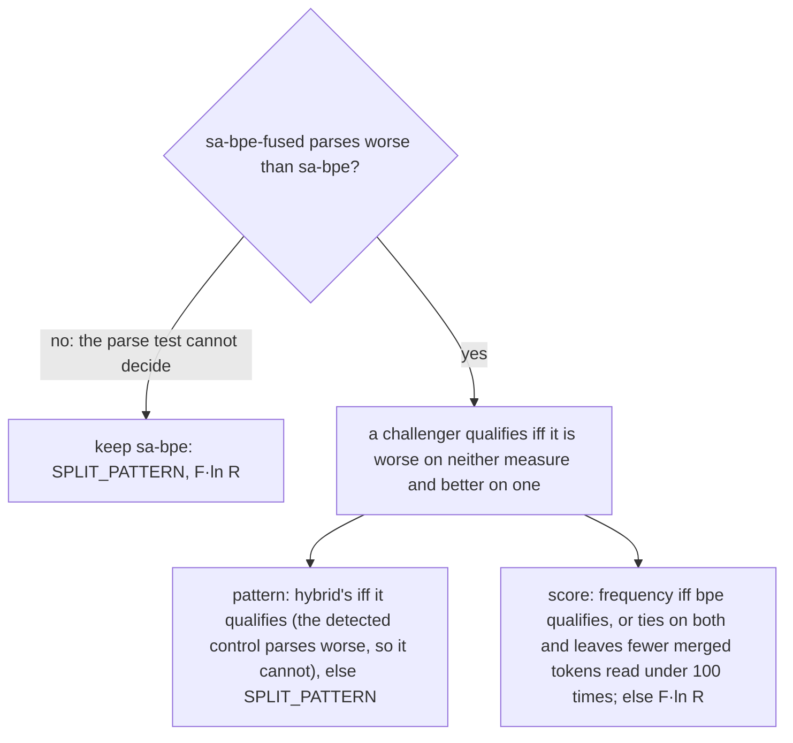

# Tokenizer ablation

The experiment decides the split pattern and the merge score of the corpus's tokenizer, the vocabulary every later
step of pre-training reads. The code is `ablations/tokenizer.py` (the arms, steps and decision), over
`corpus/train_tokenizer.py` (the sample and trainer) and `ablations/contrast.py` (the pre-registered tests). The records
are in `results/tokenizer_split_merge-*.json`. Every figure below comes from those records unless it is marked
[arithmetic] (derived from them), [inference] or [unverified] (measured, record not kept).

## Status

| Step | State | Record | Code | Machine, wall time |
|---|---|---|---|---|
| `vocabularies` | done, 2026-10-24 | `results/tokenizer_split_merge-vocabularies.json` | `5ba5025` | GH200, 737 s |
| `intrinsic` | done, 2026-10-24 | `results/tokenizer_split_merge-intrinsic.json` | `ebd8058` | GH200, 114 s |
| `data` | done, 2026-10-24 | `results/tokenizer_split_merge-data.json` | `ba01bb5` | GH200, 3,002 s |
| `runs` | ready; waits for the user's approval | `results/tokenizer_split_merge.json`, `.jsonl` | | |
| `adopt` | after `runs` | `artifacts/corpus/tokenizer` | | |

The arms' vocabularies are in `artifacts/corpus/tokenizer-ablation/<arm>/` (`tokenizer.tiktoken`, `tokenizer.pattern`,
`merges.json`), and their tokenized val splits are in `artifacts/corpus/tokenizer-ablation/tokenized/` (72 splits,
13 GB), on the GH200.

## Fixed across arms

- **Vocabulary size:** 32,768 ids: the 256 bytes, 32,508 merges, BOS and three FIM sentinels (`<｜fim▁begin｜>`,
  `<｜fim▁hole｜>`, `<｜fim▁end｜>`); the reason for the size is in `docs/corpus.md` §9.
- **Trainer:** the corpus crate's byte-level BPE (`corpus/crate/train.rs`), within the chunks of the arm's
  split pattern. Every merge is an argmax with fixed tie-breaks, so the arms are trained concurrently and
  independently. Training is deterministic: a second training of the four arms gave identical vocabularies
  [unverified].
- **Encoder:** tiktoken, whose regex engine (fancy-regex) the trainer shares.
- **Sample:** one draw, shared by every arm (below).
- **Evaluation text:** the val splits of the corpus's 18 sources, 6.21 GB of text [arithmetic].

### Sample

Each of the file stage's 17 sources contributes its share of the stage's bytes as its share of 13.38 GB
(`corpus/train_tokenizer.py` `SAMPLE_BYTES`). A source's share of the stage's bytes is its share of the stage's
tokens (`mixture.FILE_LEVEL_STAGE`) at the reference tokenizer's bytes per token (`mixture.BYTES_PER_TOKEN`). Within a
source the sample is systematic, in shard order: row i is taken when floor((i + 1)·f) > floor(i·f), where f is the
fraction of the source's rows taken.

Rationale:
- Tokenizer training data should be "representative of model training data" (arXiv 2405.05417 §5).
- Across tokenizer training mixes, a subset's compression "only varies by 5 to 6 percentage points" and rises with its
  share of the mix (arXiv 2402.01035 §2.3).
- Proportional tokenizer-training weights gave lower bits per byte than equal weights (arXiv 2610.12144 App. D,
  Table 6; §7).

Authorship units (SA-BPE's R):
- Repository files and functions: the repository, its name lowercased, so one unit spans every source that holds it.
  SA-BPE uses this unit.
- Every other document is its own unit. SA-BPE suggests this for natural language ("documents, books, or document
  collections", arXiv 2604.14053 §6) but does not test it.

The draw: 3,988,600 documents, 13.44 GB, 3,429,396 authorship units, 31 s on 64 cores. Code is 85.6% of its bytes
[arithmetic].

| Source | Target GB | Fraction of rows | Documents | GB | Units |
|---|---|---|---|---|---|
| stack_edu_python | 1.185 | 0.0178 | 435,558 | 1.187 | 384,949 |
| ultradata_stack_v3_l2_python | 1.462 | 0.0178 | 311,593 | 1.473 | 291,342 |
| ultradata_code_l2_python | 2.631 | 0.0178 | 747,214 | 2.662 | 643,565 |
| stack_edu_cpp | 0.770 | 0.0178 | 285,543 | 0.781 | 232,119 |
| ultradata_stack_v3_l2_cpp | 0.842 | 0.0178 | 219,730 | 0.845 | 145,740 |
| ultradata_code_l2_cpp | 0.645 | 0.0178 | 233,492 | 0.645 | 139,446 |
| ultradata_code_l3_python | 0.352 | 0.0345 | 135,008 | 0.352 | 135,008 |
| ultradata_code_l3_cpp | 0.363 | 0.0345 | 147,939 | 0.363 | 147,939 |
| nemotron_rewriting_python | 2.227 | 0.0345 | 624,869 | 2.227 | 624,869 |
| nemotron_transpilation_cpp | 0.756 | 0.0345 | 176,998 | 0.755 | 176,998 |
| kaggle_notebooks | 0.197 | 0.0383 | 22,001 | 0.207 | 22,001 |
| codexglue_python | 0.008 | 0.0383 | 9,554 | 0.008 | 3,738 |
| climbmix | 1.588 | 0.0341 | 532,506 | 1.586 | 532,506 |
| ultradata_math_l3_qa | 0.081 | 0.0309 | 33,157 | 0.082 | 33,157 |
| ultradata_math_l3_conversation | 0.077 | 0.0309 | 20,645 | 0.078 | 20,645 |
| ultradata_math_l3_multi_style | 0.106 | 0.0309 | 20,995 | 0.105 | 20,995 |
| ultradata_math_l3_textbook_exercise | 0.089 | 0.0309 | 31,798 | 0.089 | 31,798 |

The repository sources' sampled bytes exceed their targets by the path comment prepended to each file
(`sources.texts`), which the target, taken from Parquet footers, does not count. Codeforces-CoTs is read only by the
32K stage and is not sampled.

## Arms

| Arm | Split pattern | Merge score | Role |
|---|---|---|---|
| sa-bpe | `SPLIT_PATTERN` (the reference tokenizer's) | SA-BPE, F·ln R | baseline: the reference tokenizer's recipe on this corpus |
| sa-bpe-fused | `FUSED_PATTERN` | F·ln R | positive control: line breaks fused to punctuation |
| hybrid | `HYBRID_PATTERN` | F·ln R | whitespace: line breaks and indentation as chunks of their own |
| bpe | `SPLIT_PATTERN` | frequency F | score: SA-BPE against plain BPE |

The score is either F·ln R (arXiv 2604.14053 §4.1) or frequency alone, where:
- F is the pair's frequency;
- R is the number of authorship units holding the pair in the current segmentation, so a pair held by one unit scores 0;
- the log is natural, as in pchizhov/sa-bpe's `scoring.py`.

```text
SPLIT_PATTERN   '(?i:[sdmt]|ll|ve|re)|[^\r\n\p{L}\p{N}]?+\p{L}+|\p{N}{1,2}| ?[^\s\p{L}\p{N}]++|\s*[\r\n]|\s+(?!\S)|\s+
FUSED_PATTERN   '(?i:[sdmt]|ll|ve|re)|[^\r\n\p{L}\p{N}]?+\p{L}+|\p{N}{1,2}| ?[^\s\p{L}\p{N}]++[\r\n]*|\s*[\r\n]|\s+(?!\S)|\s+
HYBRID_PATTERN  (?:[^\s\p{L}\p{N}]| )?+\p{L}+|\p{N}{1,2}| ?[^\s\p{L}\p{N}]++|\n+|\r+|\t+| +|[^\S\r\n\t ]+
```

`SPLIT_PATTERN` is cl100k's pattern with two changes: digits split in runs of one or two (`\p{N}{1,2}`), and no line
break after a punctuation run.

`FUSED_PATTERN` is karpathy/nanochat's pattern (92d63d4): `SPLIT_PATTERN` plus `[\r\n]*` after the punctuation run,
so `"):\n"` is one chunk.

## Comparisons

Each challenger is compared with sa-bpe and differs from it in one named respect, except the hybrid, which changes
three clauses together.

### Fused line breaks: sa-bpe-fused against sa-bpe (the positive control)

**Difference:** the single `[\r\n]*` that lets a punctuation run take the line breaks after it. This is the deletion
measured in arXiv 2608.18062's companion post ("Tokenizer Code Ablations", section *Controlled comparisons*):
- **Three seeds:** gpt4onl against gpt4o, the tokenizer corpus held fixed, gives MBPP pass@1 of 0.224, 0.246 and 0.220
  against 0.167, 0.072 and 0.018 (subsection *Differing one regex clause*).
- **One run per code fraction:** over tokenizer corpora of 0, 5, 30 and 50% code, the non-fusing pattern scores +0.016
  (p = 0.41), +0.156, +0.046 and +0.124 (p = 4.7e-12) above the fusing one (*Varying regex clause and tokenizer
  training corpus independently*; exact McNemar test, the post's App. D).
- **Applicability:** this corpus's sample is 85.6% code, beyond the post's highest rung [arithmetic]. Prompts are
  healed, as in arXiv 2608.18062 §4.3 and App. C.1.

**Role:** a known effect that the parse test must detect at d16 before it may decide anything else. If it is not
detected, the corpus keeps sa-bpe (Decision).

**Intrinsic record:**
- Line-break entries: 748 against sa-bpe's 72, 693 of them fusing punctuation with a line break against 0. The post
  counts 1,091 and 74 for gpt4o and gpt4onl (App. B, *Seed noise in a single run*).
- Compression: the best of the arms, 6.7% more bytes per token over the file stage (3.868 against 3.624), and 6.5%
  fewer val tokens [arithmetic].
- Extent margins: the lowest of the arms; synthetic code 1.017.

The arm that compresses best is the one expected to parse worst. The post finds code bits per byte "shows no
association with MBPP at any level" (section *Code bits per byte*), so compression does not rank the arms.

### Whitespace: hybrid against sa-bpe

The hybrid changes three things:
1. **Line breaks:** `\n+` and `\r+` are chunks of their own. A line break joins neither the punctuation before it (as
   `SPLIT_PATTERN` already ensures) nor the whitespace before it (`SPLIT_PATTERN`'s `\s*[\r\n]` joins it) nor the
   indentation after it.
   - This is the forced break at line breaks of the post's MinGram `cb_nl`, which scored MBPP 0.216 against `cb`'s
     0.016, whose pretokens join a line break to the next line's indentation.
   - No prompt ends inside a token that spans its last line break, the token-boundary bias DeepSeek-V3 describes for
     multi-line prompts without a terminal line break (arXiv 2412.19437 §4.1).
2. **Indentation:** a run of spaces and a run of tabs are chunks of their own (` +`, `\t+`), and a letter run takes no
   tab before it. An indentation of at least two spaces or at least one tab therefore ends at a chunk end, and
   chunks(indentation + statement) = (indentation,) + chunks(statement). A statement has the same tokens at every
   depth.
   - Under `SPLIT_PATTERN`, `\s+(?!\S)` gives the indentation's last space to the statement (`" if"` against `"if"`
     at depth 0), and `[^\r\n\p{L}\p{N}]?+` takes a tab (`"\tif"`).
3. **Contractions:** the contraction clause is dropped (arXiv 2402.01035 App. E, Fig. 3: the Punct pattern drops it),
   so `'self` is not cut into `'s` and `elf`.

Kept from `SPLIT_PATTERN`:
- one leading punctuation character or space on a letter run (`".append"`, `" foo"`): GPT-4's pattern gives "an
  additional 5% compression over Punct at no significant cost to performance" (arXiv 2402.01035 App. E);
- digit pairs and punctuation runs.

The hybrid as a whole is untested in the literature, and a difference in its runs cannot be attributed to one of the
three changes.

**Intrinsic record:**
- Depth invariance is 97.9–100% of indented lines per program source, against at most 13.8% for the other arms.
  - Every non-invariant line has an indentation outside clause (2)'s condition, ending in a single space that the
    letter clause takes: over stack_edu_python, stack_edu_cpp, nemotron_transpilation_cpp and ultradata_code_l3_cpp,
    2,006 lines indented by one space and 63 whose indentation ends in a tab and then a space, all 2,069 of the
    hybrid's non-invariant lines there (classified on the GH200 from the same lines).
- Line-break entries: 9 against 72.
- Compression: 0.2% fewer bytes per token (3.616 against 3.624).

### Merge score: bpe against sa-bpe

**Difference:** the score alone, frequency F against F·ln R, within the same pattern. In SA-BPE's Table 3
(arXiv 2604.14053), F·log R gives the highest compression of the scores compared and far fewer verified under-trained
tokens than frequency (one tokenizer each, no seeds). SA-BPE's recommended F·log R·L (Table 4) is not an arm, because
for natural language "the language aspect must be avoided" (§6).

**Intrinsic record:**
- Compression: equal (3.623 against 3.624 bytes per token).
- Rarely-read merged tokens: 84 of bpe's 32,508 merged tokens are read fewer than 100 times on the val splits, against
  54 of sa-bpe's. Never read: 15 against 5. This is SA-BPE's coverage claim on this corpus, graded.
- Under the pre-registered tie-break, a tie on both run measures keeps F·ln R.

### Not compared

- PickyBPE's token removals (arXiv 2409.04599 Alg. 2) and BoundlessBPE's supermerges (arXiv 2504.00178 §3.2): tiktoken
  encodes by merge rank alone and has no form for either.
- SuperBPE: its code results moved HumanEval and MBPP pass@10 in opposite directions, neither significantly
  (arXiv 2503.13423 Table 1).
- The sample's composition: one rule, proportional to the file stage (above).
- Vocabulary size: fixed at 32,768.

## Intrinsic measures

Each measure plans the runs, gates their validity, tests an arm's mechanism or breaks the decision's tie.

- **Bytes per token** of a source: its val bytes over its val tokens.
  - File stage's: Σ_s w_s / Σ_s (w_s / b_s) over the stage's byte shares w_s, so it compares arms at equal bytes. Also
    computed per group.
  - It sets an arm's token budget in the runs and the corpus's compile and pack budgets.
- **Train tokens over draw (extent margin):** per group read in part (synthetic code, text, math), the train tokens of
  its sources under the arm over the group's draw. Below 1, the corpus's extent is too small for that arm.
- **Validity, asserted** (a failure stops the step):
  - every arm's tokenized val documents hold the same bytes;
  - on each source's first 200 val texts, the pattern's chunks (Python `regex`) cover the text;
  - tiktoken's encoding of every chunk equals the arm's merges replayed in training order (Hugging Face `tokenizers`'
    BPE model);
  - every text decodes back.
- **Line-break entries:** vocabulary entries holding a line break, fusing punctuation with one
  (`[^\s\p{L}\p{N}][\r\n]`), and ending in a line break and indentation (`[\r\n][ \t]+\Z`).
  - Across the post's 58 tokenizers, the count of entries holding a line break correlates with mean MBPP pass@1 at
    Spearman ρ = −0.719 (section *The new-line vs. performance association across all 58 tokenizers*).
  - Tokenizers with entries joining punctuation to a line break average MBPP 0.095, against 0.206 for those without
    (App. D).
- **Depth invariance:** of each program source's first 50,000 indented val lines (codexglue_python: 34,317), the share
  whose tokens equal the indentation's tokens followed by the statement's tokens at depth 0.
- **Merged reads:** how many merged tokens (ids 256 to 32,763) the val documents read never, under 10 and under 100
  times.

Not measured: TokEval's intrinsic metrics, which no decision reads.
- Of its 14 metrics, only AST alignment predicts MBPP, and the paper attributes that "to the vocabulary's line-break
  handling" (arXiv 2608.18062 §5), which the line-break entries measure directly.
- Rényi efficiency predicts neither code bits per byte nor MBPP (arXiv 2608.18062 Table 2).

## Intrinsic results

Every arm passed every validity check. 3,600 val texts per arm were checked chunk by chunk:

| Arm | Chunks matching the trained merges |
|---|---|
| sa-bpe | 5,896,011 |
| sa-bpe-fused | 5,584,068 |
| hybrid | 5,900,066 |
| bpe | 5,896,011 |

**Bytes per token, file stage and groups**

| Group | sa-bpe | sa-bpe-fused | hybrid | bpe |
|---|---|---|---|---|
| file stage | 3.624 | 3.868 | 3.616 | 3.623 |
| repository | 3.442 | 3.698 | 3.432 | 3.443 |
| synthetic | 3.861 | 4.161 | 3.857 | 3.861 |
| notebooks | 3.403 | 3.617 | 3.413 | 3.403 |
| functions | 4.018 | 4.314 | 4.020 | 4.019 |
| text | 4.243 | 4.295 | 4.237 | 4.230 |
| math | 3.186 | 3.306 | 3.178 | 3.185 |
| val tokens | 1,739,851,130 | 1,626,775,376 | 1,744,375,884 | 1,739,939,319 |

**Bytes per token, per source**

| Source | Val MB | sa-bpe | sa-bpe-fused | hybrid | bpe |
|---|---|---|---|---|---|
| stack_edu_python | 679 | 3.442 | 3.645 | 3.432 | 3.443 |
| stack_edu_cpp | 440 | 3.074 | 3.357 | 3.060 | 3.075 |
| ultradata_stack_v3_l2_python | 924 | 3.706 | 3.958 | 3.691 | 3.706 |
| ultradata_stack_v3_l2_cpp | 459 | 3.022 | 3.279 | 3.009 | 3.023 |
| ultradata_code_l2_python | 1,630 | 3.734 | 4.002 | 3.728 | 3.735 |
| ultradata_code_l2_cpp | 345 | 2.978 | 3.235 | 2.970 | 2.981 |
| ultradata_code_l3_python | 104 | 3.892 | 4.084 | 3.881 | 3.892 |
| ultradata_code_l3_cpp | 106 | 3.615 | 3.823 | 3.607 | 3.614 |
| nemotron_rewriting_python | 651 | 3.960 | 4.282 | 3.957 | 3.959 |
| nemotron_transpilation_cpp | 221 | 3.697 | 4.033 | 3.695 | 3.696 |
| codexglue_python | 1 | 4.018 | 4.314 | 4.020 | 4.019 |
| kaggle_notebooks | 51 | 3.403 | 3.617 | 3.413 | 3.403 |
| codeforces_cots | 11 | 3.469 | 3.603 | 3.465 | 3.467 |
| climbmix | 469 | 4.243 | 4.295 | 4.237 | 4.230 |
| ultradata_math_l3_qa | 27 | 2.932 | 3.058 | 2.929 | 2.933 |
| ultradata_math_l3_conversation | 26 | 3.492 | 3.579 | 3.486 | 3.490 |
| ultradata_math_l3_multi_style | 35 | 3.306 | 3.437 | 3.298 | 3.303 |
| ultradata_math_l3_textbook_exercise | 29 | 3.061 | 3.186 | 3.048 | 3.061 |

**Extent margins** (train tokens over draw; below 1 the corpus would need a larger extent)

| Group | sa-bpe | sa-bpe-fused | hybrid | bpe |
|---|---|---|---|---|
| synthetic | 1.096 | 1.017 | 1.097 | 1.096 |
| text | 1.071 | 1.058 | 1.072 | 1.074 |
| math | 1.169 | 1.126 | 1.171 | 1.169 |

**Line-break entries and merged reads**

| Measure | sa-bpe | sa-bpe-fused | hybrid | bpe |
|---|---|---|---|---|
| entries holding a line break | 72 | 748 | 9 | 67 |
| punctuation fused with a line break | 0 | 693 | 0 | 0 |
| ending in a line break and indentation | 5 | 0 | 0 | 5 |
| merged tokens read never | 5 | 5 | 5 | 15 |
| read under 10 times | 11 | 11 | 13 | 26 |
| read under 100 times | 54 | 54 | 56 | 84 |

**Depth invariance** (% of indented val lines)

| Source | sa-bpe | sa-bpe-fused | hybrid | bpe |
|---|---|---|---|---|
| stack_edu_python | 0.9 | 0.9 | 99.9 | 0.9 |
| stack_edu_cpp | 13.8 | 13.8 | 98.9 | 13.6 |
| ultradata_stack_v3_l2_python | 0.3 | 0.3 | 99.9 | 0.3 |
| ultradata_stack_v3_l2_cpp | 2.4 | 2.4 | 99.1 | 2.4 |
| ultradata_code_l2_python | 0.0 | 0.0 | 100.0 | 0.0 |
| ultradata_code_l2_cpp | 3.7 | 3.7 | 99.5 | 3.7 |
| ultradata_code_l3_python | 0.0 | 0.0 | 100.0 | 0.0 |
| ultradata_code_l3_cpp | 0.0 | 0.0 | 99.1 | 0.0 |
| nemotron_rewriting_python | 0.0 | 0.0 | 100.0 | 0.0 |
| nemotron_transpilation_cpp | 0.0 | 0.0 | 97.9 | 0.0 |
| codexglue_python | 0.0 | 0.0 | 100.0 | 0.0 |

## Runs (pre-registered; wait for the user's approval)

**Design:**
- Every arm at d16, two seeds each (0 and 1): 8 runs through `python run.py experiment=tokenizer_split_merge`
  (`conf/experiment/tokenizer_split_merge.yaml`), each with the base model's code paths and its own plan (`schedule.plan` at its
  tokens); the decision is `ablations.tokenizer.decide` over the records grouped by `config.tokenizer`.
- **Equal bytes:** each run reads the set's code documents once, so an arm's tokens are their bytes over its bytes per
  token. Text and math are drawn by rows. At equal bytes, the arm that compresses better trains on fewer tokens and
  fewer steps [arithmetic].
- **Contexts:** the corpus's 8,192 and 32,768 tokens. Bits per byte is also reported by byte offset, the bytes of
  context a better compressor sees (arXiv 2503.13423 §3.1, App. B.1).
- **Size of the set** (`document_set`): 20 tokens per non-embedding parameter of d16 under sa-bpe (arXiv 2203.15556
  Table 3; d16 at 20 is 4,552 steps of 294,912 tokens). Each code corpus takes the fewest leading train shards whose
  estimated sa-bpe tokens hold its file-stage draw; text, math and the repository corpora hold `MARGIN` (1.5) times
  their draws. Whole shards hold more than the draw: every arm's `max_tokens_per_param` on the set is 29.5–31.5 (sa-bpe
  31.42, sa-bpe-fused 29.48, hybrid 31.49, bpe 31.42), 6,710–7,167 steps of 3 micro-batches
  (`results/tokenizer_split_merge-data.json`).

**Measures:**
- **Parsing:** per MBPP+ problem, whether the healed greedy completion compiles. MBPP+ alone, because its prompts leave
  the function header to the model, and "an evaluation that uses HumanEval alone does not expose this type of defect"
  (the post, section *HumanEval*).
- **Code bits per byte** at 8K.

**Contrasts,** each challenger against sa-bpe on the seeds where both have an evaluation (a diverged run drops its
seed from both sides):
- **Parsing:** per problem, the number of seeds whose completion compiles under the challenger minus under sa-bpe; the
  exact sign test over the problems whose difference is non-zero (McNemar's exact test at one seed, the post's App. D).
  Better or worse at p < 0.05, else equal.
- **Code bits per byte:** the difference of the arms' seed means. Better or worse beyond 1.96·σ·√(2/n), else equal.
  - σ = 0.0034 (`CODE_SIGMA`) is the pooled seed standard deviation of 8K code bits per byte, from six d8 runs at 20
    tokens per parameter on the reference tokenizer's data (records not in `results/` [unverified]), carried to d16
    and to this corpus [inference].
  - At n = 2 the margin is 0.0067 bits per byte [arithmetic].

**Decision** (`results/tokenizer_split_merge.json` `"analysis"` `"decision"`):



Two outcomes already follow from the intrinsic record and the rules:
- A detected control is worse on parsing and so cannot qualify, so the pattern is the hybrid's or `SPLIT_PATTERN`.
- bpe leaves more rarely-read tokens than sa-bpe (84 against 54), so the score changes to frequency only if bpe is
  better on one run measure and worse on neither.

`adopt` then writes the decided vocabulary to `artifacts/corpus/tokenizer`: the matching arm's files, or, if the
frequency score is carried to the hybrid's pattern, that pair trained on the same sample [inference: that pair is
untested].

## Threats to validity

- One sample draw and one vocabulary size. The sample's composition is fixed by rule, not ablated.
- Two seeds at d16. The literature's evidence is from one 24-layer model of about 1.27B parameters with 128K–131K
  ids, mostly on one Python benchmark (the post, *What we trained*, *Scope and limitations*), so a dismissal here rests
  on these runs alone.
- σ comes from d8 runs on the reference tokenizer's data [unverified, inference].
- The positive control's effect is documented at tokenizer corpora of up to 50% code; this sample is 85.6% code.
- The document as the authorship unit of non-repository text is untested in SA-BPE (arXiv 2604.14053 §6).
- The hybrid changes three clauses at once.

## Reproduction

Inside the project image on the GH200 (64 Neoverse-V2 cores, 525 GB; Python 3.12.3, tiktoken 0.14.0, tokenizers
0.23.2 as the records' provenance states, numpy 2.1.0, scipy 1.18.1, pyarrow 26.0.0, regex 2026.9.29), after
`python -m corpus.publish pull`:

```bash
python -m ablations.tokenizer vocabularies   # sample, then the four arms at once
python -m ablations.tokenizer intrinsic      # 72 val tokenize jobs and every measure, one process pool
python -m ablations.tokenizer data           # the d16 set tokenized and packed under every arm
python run.py experiment=tokenizer_split_merge   # the 8 runs and the decision
python -m ablations.tokenizer adopt
```

| Phase | Wall time |
|---|---|
| sample (64 workers) | 31 s |
| training, concurrent: sa-bpe / sa-bpe-fused / hybrid / bpe | 690 / 683 / 687 / 624 s |
| val tokenize jobs, 4 arms × 18 sources | 53 s |
| measures | 19 s |
| `data`: tokenize and pack of the d16 set under every arm | 2,767 s and 235 s |
